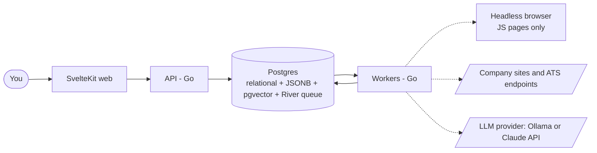

# Job Search Automator: Architecture & Learning Plan

Last synced from the Claude Doc: Oct 25, 2026.

## Purpose and goals

This project has two equal goals: a job-search tool that maps companies and scores postings against your resume, and hands-on, interview-ready experience with the stack that runs it (Kubernetes, Go, SvelteKit, Postgres with pgvector, and LLM pipelines).

**What the app does**

- You submit a company URL, a single job URL, or pasted job text. Nothing runs on a schedule and nothing crawls job boards.
- It builds a versioned profile of each company: what they do, how they work, and the kinds of roles they hire for.
- It analyzes a posting against your resume and reports matched skills, gaps, and red flags.
- When you apply somewhere, it suggests similar companies and open roles you may also want to apply to.
- Over time it becomes a knowledge map of the companies you have looked at.

**What the learning goal means for the plan**

- Every component gets a learn-first step before it is built: concepts, a small throwaway exercise, and a short check that you can explain it.
- The architecture favors technologies that appear in real job postings over the lightest possible option, as long as the complexity stays manageable for one person.
- You should be able to talk about each piece in an interview: why it was chosen, what the trade-offs were, and what broke.

**Scope for version 1**

One user (you), running locally on a laptop cluster, with no billing. The design keeps a path open to a multi-user subscription service with Stripe, but none of that is built until the core works.

## Key decisions

Seven decisions shape everything else; each has a reason and a point at which it should be revisited.

| Decision | Choice | Why | Revisit when |
| --- | --- | --- | --- |
| Trigger model | User-initiated only: submit a company URL, job URL, or pasted text | Avoids crawling, scraping, and job-board terms-of-service problems; keeps load small | You want alerts on new roles at tracked companies |
| Center of the data model | Companies, with postings, analyses, and applications attached | Your goal is a knowledge map and similar-role discovery, not a flat list of jobs | Never likely |
| Database | Postgres with pgvector | Relational data, JSONB, and vector search in one store; fits Stripe state later; row-level security for tenancy | Corpus grows past a few hundred thousand vectors |
| Job queue | River, a Go library that stores jobs in Postgres | No extra infrastructure; transactional enqueueing; retries built in | Throughput or fan-out needs exceed Postgres |
| Embeddings | Separate vectors per company for what they do, how they work, and roles they hire for | Lets a query weight the meaning of "similar" differently without re-researching | Search quality is poor in practice |
| Local environment | kind or k3d cluster, Tilt for the dev loop, Kustomize for manifests | Real Kubernetes with fast iteration and no cloud bill | You deploy to a cloud cluster |
| Multi-tenancy | A tenant_id on every table and message, auth behind an interface, billing deferred | Cheap now, very expensive to retrofit | Before the first outside user |

**Design principles**

- Every background job is idempotent and keyed by tenant, so retries are safe.
- Every extracted fact keeps its source URL and fetch time.
- LLM calls sit behind an interface, return structured output, and are cached by input hash with prompt and model versions recorded.
- Fetching is polite and bounded: a small page cap per company, robots.txt respected, no attempts to bypass logins or bot protection. A paste-the-text fallback covers blocked pages.
- Build the smallest working slice first, then widen it.

## System overview

The API and the workers never call each other: the API enqueues jobs in Postgres, and workers pick them up, fetch pages, call the LLM provider, and write results back.

Dashed boxes sit outside the cluster. Six services, two external.

**Responsibilities**

- **SvelteKit web:** the dashboard, company and posting pages, resume view, and live progress for submitted work.
- **API (Go):** validates submissions, writes them with their jobs in one transaction, serves read queries, and streams job status.
- **Workers (Go):** run every background job, including fetching, LLM extraction, embedding, matching, and related-role ranking.
- **Headless browser:** an isolated pod used only when a page needs JavaScript to render.
- **Postgres:** the single store for relational data, JSON documents, vectors, and the job queue.
- **External services:** the company and applicant-tracking pages you point it at, and the LLM provider behind one Go interface.

## Core flows

Every flow starts with something you submit and returns immediately with a job ID; the work happens in background jobs and the UI shows live progress.

**1. Research a company**

1. You submit a company URL. The API validates it and creates a company record with status queued.
2. A fetch job retrieves a bounded set of pages (homepage, about, careers, and perhaps the engineering blog or product pages, capped at about 5 to 10).
3. An extraction job asks an LLM for a structured profile: what they do, industry, products, customers, stage and size, tech stack, locations, remote policy, culture signals, and the kinds of roles they hire for.
4. Each claim is stored with its source URL and fetch time.
5. An embedding job creates three vectors: what they do, how they work, and roles they hire for.
6. A relations job links the company to its nearest neighbors in your map.

**2. Submit a job posting**

1. You paste a job URL or the text itself. The pasted-text path skips fetching.
2. For a URL, the fetch job tries the known applicant-tracking endpoints first (Greenhouse, Lever, Ashby, Workable), then a plain HTTP fetch, then a headless browser only for pages that need JavaScript.
3. An extraction job turns the text into a structured posting and classifies it into a stable job family and seniority taxonomy.
4. The posting is linked to its company, which is created and queued for research if new.
5. An analysis job compares the posting to your current resume version and stores matched skills, gaps, red flags, and a scored explanation.

**3. After you apply: find similar opportunities**

1. You mark a posting as applied.
2. A related-opportunities job finds the nearest companies by embedding and by shared facets such as industry, stack, and stage.
3. It gathers their known postings, plus similar postings anywhere in your database.
4. It ranks them by resume fit, using cached analyses where they exist and a cheap embedding score otherwise. The full LLM analysis runs only when you open a posting.
5. The UI shows a short list: you applied to X, here are roles at similar companies.

**4. Refresh a company's open roles**

A button you press for one company at a time. It fetches that company's careers page or applicant-tracking endpoint and extracts the open roles, then runs flow 2 for the ones you choose.

**5. When a page cannot be fetched**

Pages behind logins or bot walls fail cleanly with a clear status, and the UI offers a paste box. Nothing tries to get around the block.

## Data model

Companies sit at the center. Profiles are versioned so you can see how a company changes, and every table carries a tenant_id from day one.

| Table | Holds | Notes |
| --- | --- | --- |
| tenants, users | Who owns the data | One tenant and one user for now; auth is behind an interface |
| resumes | Versioned resume text and parsed sections | Analyses reference a specific version, so results stay reproducible |
| resume_chunks | Skills and experience sections with embeddings | Used to give the LLM focused context |
| companies | Identity, URL, status | One row per company per tenant |
| company_profiles | Versioned structured profile and summary | A new row each time you re-research; the latest is current |
| company_embeddings | Three vectors per profile version: what they do, how they work, roles they hire for | Separate vectors let queries weight each meaning; each row also stores the embedding model name |
| company_sources | Pages fetched, with URL, fetch time, and content hash | Provenance for every claim |
| company_relations | Company A, company B, type, score, reason | Types: similar-to, competitor-of, same-sector. Plain rows, no graph database |
| postings | Structured posting linked to a company | Job family, seniority, extracted skills, first-seen and last-seen dates, raw text, embedding |
| analyses | Resume version, posting, result JSON, score | Also stores model, prompt version, token counts, and cost |
| applications | Posting, status, dates, notes | Status is a closed set: saved, applied, interviewing, rejected, offer |
| submissions | What you submitted, type, status, error | One row per user action; links to the jobs it spawned |
| usage_events | Tenant, kind, tokens, cost | Doubles as LLM cost tracking now and Stripe metering later |

**Tenancy approach**

- A single repository layer in Go requires a tenant ID for every query, so unscoped queries cannot be written by accident.
- Postgres row-level security is added as a second line of defense once you reach the multi-user stage.
- The tenant ID travels in the request context and in every queued job's arguments.

**Vector search**

- pgvector stores embeddings in the same database as everything else, so a similarity query can filter by facets and join to applications in one SQL statement.
- Start with exact search, which is fast enough for thousands of rows, then add an HNSW index when the corpus justifies it. Doing it in that order teaches you what the index actually changes.

**Job taxonomy (open)**

Postings are classified into a small, stable set of job families and seniority levels that you define. Without this, title variations such as "backend engineer" and "software engineer II, platform" cannot be aggregated or compared across companies. The taxonomy is not yet defined.

## Background jobs and LLM pipeline

All slow work runs as River jobs in worker pods; the API only enqueues them and reads results.

| Job | Triggered by | Does | Writes |
| --- | --- | --- | --- |
| company.research | Company URL submitted | Fetches bounded pages, then enqueues extraction | company_sources |
| company.extract | Fetch complete | LLM builds the structured profile | company_profiles |
| company.embed | Profile created | Creates three embeddings | company_embeddings |
| company.relate | Embeddings created | Finds nearest companies and facet overlaps | company_relations |
| company.refresh_roles | Button press | Fetches the careers page or ATS endpoint, lists open roles | postings (unanalyzed) |
| posting.fetch | Job URL submitted | ATS endpoint, plain HTTP, or headless browser | postings (raw text) |
| posting.extract | Raw text available | LLM structures it and assigns job family and seniority | postings |
| posting.analyze | Extraction done, or you open a posting | LLM compares posting to resume version | analyses |
| related.compute | You mark an application | Ranks similar companies' roles by fit | A ranked list in the UI |

**Reliability rules**

- Every job is idempotent: running it twice produces the same state. Keys combine tenant, subject, and input hash.
- Jobs retry with backoff; permanent failures write a readable error to the submission row so the UI can show it.
- Enqueueing happens in the same database transaction as the write that caused it, so no job is lost or duplicated.

**LLM rules**

- All model calls go through one Go interface. The provider is a per-task setting: Ollama locally by default, with a switch to the Claude API for extracting or analyzing the postings and companies you care most about.
- Responses are requested as structured JSON, validated against a schema, with one automatic repair retry.
- Results are cached by a hash of the input, the resume version, the prompt version, and the model name.
- Every call records tokens and cost to usage_events.
- Prompts live in version-controlled files, not inline strings, and each has a small set of saved example inputs you can re-run after changes.
- For matching, the cheap embedding comparison narrows candidates first, and the LLM runs only on the few that matter.
- Embeddings stay on one local Ollama model. Vectors from different models cannot be compared, so the model name is stored with every embedding, and changing it means re-embedding everything.
- Local models are less reliable at strict JSON, so schema validation, the repair retry, and the saved test set matter more. The same test set shows how much a Claude run improves a result.
- Ollama runs on your machine outside the cluster, and workers call it over the network.

## Kubernetes and local dev environment

Everything runs in a local kind or k3d cluster on Docker Desktop, with Tilt rebuilding and redeploying on every code change, so the cluster is real but the loop is fast.

| Workload | Kubernetes kind | Notes |
| --- | --- | --- |
| SvelteKit web | Deployment and Service | Node adapter; talks to the API over the cluster network |
| API (Go) | Deployment and Service | Stateless; enqueues jobs, serves reads, streams progress with server-sent events |
| Workers (Go) | Deployment | Same binary as the API in worker mode, or a separate one; scale on queue depth later with KEDA |
| Headless browser | Deployment | Separate pod with tight resource limits, used only for JavaScript-rendered pages |
| Postgres | CloudNativePG cluster, or a plain StatefulSet first | Learn the plain StatefulSet before the operator |
| Migrations | Job | Runs before the API rolls out; use a tool such as goose or atlas |
| Config and secrets | ConfigMap and Secret | LLM API keys stay in Secrets; never in images or git |
| Ingress | Ingress controller, or port-forward at first | Add the controller when you want a friendly local hostname |

**Repo layout (monorepo)**

- `services/api`, `services/worker`, and `services/browser`, each with its own Dockerfile
- `web` for the SvelteKit app
- `pkg` for shared Go code: tenancy, events, the LLM interface, the fetch layer, and job definitions
- `migrations` for SQL files
- `deploy/base` and `deploy/overlays/local` for Kustomize manifests
- `prompts` for versioned prompt files and their saved test inputs
- `docs` for this document and decision records

**Dev loop**

1. `tilt up` builds the images, applies the manifests, and shows logs for every pod in one dashboard.
2. A Go or Svelte file change triggers a rebuild and live update without a manual deploy.
3. Tests run in CI-style containers locally; the same Dockerfiles later build for a real cluster.

**Deliberately left out for now**

Service mesh, API gateway, multi-cluster, GitOps tooling, and a managed cloud database. Each is worth learning later, and none is needed to make the app work.

## Learning track

No component gets built until you have learned it in isolation, so the project teaches you the technology instead of hiding behind generated code. Each component below has the same four parts: why it matters on a resume, what to learn, a small throwaway exercise, and a check that you really understand it.

**The learning loop for every component**

1. **Read and watch** the fundamentals from the official documentation first, not tutorials of tutorials.
2. **Build a throwaway** in a scratch folder, outside the main repo, that uses only that component.
3. **Break it on purpose**: kill a pod, drop a connection, send bad input, and watch what happens.
4. **Explain it** out loud or in a short note in the docs folder, as if answering an interview question. If you cannot explain why it works, you are not done.
5. **Then build the real thing** in the project, and write down one decision and one mistake for your interview notes.

The done check is the gate: do not start the build step for a component until you can pass it.

You will build the throwaways as a lightweight side project with Claude Code while learning. Let it write code, but the done check is yours to pass without it, which keeps the learning real. If you already know a component, skip its learn step by passing its done check cold, with no studying first.

**Calibration for a senior engineer.** Treat each learn step as a short spike, from a few hours to a couple of days, not a course. Read the official docs, build the smallest exercise that exposes the component's sharp edges, and pass the done check. Spend real time only on what is new to you; the exercises below can be cut down to their breaking-it-on-purpose part.

**Your starting point.** Sorted by how much learning time each area gets:

- **Skip, quick check only:** Postgres and SQL, HTTP API design, LLM pipelines and structured output. Only look at what is specific to this project: pgvector index and distance choices, and how Ollama models behave on strict JSON.
- **Short spike (hours to a day):** SvelteKit and Svelte 5 (routing, load functions, form actions, runes; your TypeScript experience covers the rest), Docker and Tilt, Kustomize, the River job queue.
- **Real time (2 to 4 days):** Go, mainly idioms rather than syntax: error handling, interfaces, goroutines and context cancellation, project layout. Kubernetes from the designing side: Deployments vs StatefulSets, probes, resource limits, Services and Ingress, ConfigMaps and Secrets, running a migrations Job.
- **Later, when reached:** Auth/OIDC and Stripe.

### Containers (Docker)

- **Why it matters:** Nearly every platform or backend posting assumes you can build and debug images.
- **Learn:** images versus containers, layers and caching, multi-stage builds, volumes, networking basics, running as a non-root user, and what a registry is.
- **Exercise:** containerize a 20-line Go HTTP server with a multi-stage build and get the final image under 30 MB. Then run it with a read-only filesystem.
- **Done when:** you can explain why a change to one line makes the build cache rebuild only part of the image, and why the final image does not contain the Go toolchain.

### Kubernetes core

- **Why it matters:** It is the headline skill for this project and the most requested one in platform and backend roles.
- **Learn:** the control plane versus nodes, pods, ReplicaSets, Deployments and rolling updates, Services and cluster DNS, ConfigMaps and Secrets, liveness and readiness probes, resource requests and limits, Jobs and CronJobs, StatefulSets and persistent volumes, namespaces, and the basics of RBAC and service accounts. Learn to read `kubectl describe` output and events as your main debugging tool.
- **Exercise:** deploy two services in a kind cluster where one calls the other by service name. Then break it four ways: bad image tag, failing readiness probe, out-of-memory kill, and a wrong Service selector. Diagnose each using only kubectl.
- **Done when:** you can describe what happens, step by step, between running `kubectl apply` on a Deployment and a request reaching the new pod, and you can diagnose a CrashLoopBackOff without searching.

### Kustomize

- **Why it matters:** Manifest management is a constant in real teams; Kustomize and Helm are the two common answers.
- **Learn:** bases and overlays, patches, generators for ConfigMaps and Secrets, image and name transformers. Read one Helm chart afterwards so you can compare the two models.
- **Exercise:** make a base for the hello service and two overlays (local, and a pretend production with more replicas and different resource limits).
- **Done when:** you can explain when you would choose Helm over Kustomize and when the reverse.

### Tilt

- **Why it matters:** It is not a hiring keyword, but it is what makes the whole learning process pleasant.
- **Learn:** the Tiltfile, live update versus full rebuild, resource dependencies, and the dashboard.
- **Exercise:** wire the Docker and Kubernetes exercise into Tilt so a code edit shows up in the running pod within a few seconds.
- **Done when:** a one-line code change reaches the cluster without you typing any command.

### Go

- **Why it matters:** Go is the dominant language for infrastructure and cloud-native backends, which is why it pairs naturally with Kubernetes.
- **Learn:** the language tour, structs and interfaces, error handling as values, packages and modules, goroutines and channels, `context` for cancellation and timeouts, `net/http`, JSON encoding, table-driven tests, and `slog` for structured logging. Learn what a data race is and how the race detector finds one.
- **Exercise:** write a small HTTP service that fetches five URLs concurrently with a timeout, a worker pool, and clean shutdown on SIGTERM. Add tests and run them with the race detector.
- **Done when:** you can explain when to use a channel versus a mutex, why every blocking call should take a context, and how Kubernetes sending SIGTERM relates to graceful shutdown.

### Postgres and SQL

- **Why it matters:** Strong SQL is asked about in almost every backend interview, and it is where many projects are weakest.
- **Learn:** joins, indexes and how to read `EXPLAIN ANALYZE`, transactions and isolation levels, constraints, JSONB, migrations, connection pooling, and row-level security. A good free reference is Use The Index, Luke.
- **Exercise:** model companies, postings, and applications in a local Postgres. Insert 100,000 fake postings, write a slow query, then fix it with an index and show the plan before and after.
- **Done when:** you can explain why an index was or was not used, and what a transaction guarantees when two writers collide.

### Embeddings and pgvector

- **Why it matters:** Retrieval and semantic search are now a standard part of AI-adjacent backend roles.
- **Learn:** what an embedding is, cosine versus inner-product distance, why chunking matters, exact versus approximate search, and what HNSW and IVFFlat trade off. Read the pgvector README closely.
- **Exercise:** embed 50 short job descriptions, query for the nearest neighbors to one of them, and check by eye whether the results make sense. Then add an HNSW index and compare speed and recall against exact search.
- **Done when:** you can explain why approximate search can miss a true neighbor, and why a hybrid query that filters first and ranks second is useful.

### Job queues (River)

- **Why it matters:** Asynchronous work, retries, and idempotency come up in nearly every system-design conversation.
- **Learn:** at-least-once delivery, idempotency keys, retry with backoff, dead-letter handling, transactional enqueueing, and why a database queue is acceptable at this scale. Read River's documentation and compare its model with a broker such as NATS JetStream.
- **Exercise:** build a job that fails randomly. Watch it retry, then make it idempotent so that a duplicate run changes nothing.
- **Done when:** you can explain what could go wrong if a job is enqueued after a transaction commits instead of inside it.

### LLM integration

- **Why it matters:** Building reliable features on top of unreliable models is now a distinct and valued skill.
- **Learn:** structured output and JSON-schema validation, prompt design and versioning, temperature, context limits, token costs, caching, retries and rate limits, prompt-injection risks from fetched web content, and how to evaluate outputs with a small fixed test set.
- **Exercise:** extract a structured profile from five saved company pages. Score the output against answers you wrote by hand, change the prompt, and compare.
- **Done when:** you can show a measured before-and-after for a prompt change, and explain what happens if a fetched page contains instructions aimed at the model.

### SvelteKit

- **Why it matters:** Svelte is smaller in the market than React, but frontend fundamentals and full-stack framework experience transfer.
- **Learn:** components and reactivity (current Svelte uses runes), file-based routing, `load` functions, form actions, server versus client code, stores or shared state, and streaming updates with server-sent events. Work through the official tutorial at svelte.dev.
- **Exercise:** build a three-page app with a list, a detail page, and a form, backed by a mock JSON API. Add a page that updates live from a server-sent event stream.
- **Done when:** you can explain what runs on the server versus in the browser for each page, and how a form works with JavaScript disabled.

### HTTP API design

- **Why it matters:** Designing clear, safe APIs is a core backend skill.
- **Learn:** resource modeling, status codes, pagination, idempotent requests, input validation, error shapes, server-sent events versus WebSockets, and CORS. Decide between plain REST and a typed contract such as OpenAPI with generated clients.
- **Exercise:** specify the API for submitting a company and watching its progress, as an OpenAPI file, before writing any handler.
- **Done when:** the SvelteKit exercise can call a generated client against your spec.

### Observability

- **Why it matters:** Being able to find out why something is slow or broken separates juniors from seniors.
- **Learn:** structured logs, the three signal types (logs, metrics, traces), Prometheus metrics and Grafana dashboards, OpenTelemetry basics, and what to alert on.
- **Exercise:** add request-count and latency metrics to the Go exercise service, scrape them with Prometheus in the cluster, and chart them in Grafana. Add a trace across two services.
- **Done when:** you can answer where a slow request spent its time using only your tools.

### Fetching and headless browsers

- **Why it matters:** Reliable web fetching with good manners is a recurring, underrated problem.
- **Learn:** HTTP caching headers, robots.txt, user agents, timeouts and retries, HTML-to-text extraction, how JavaScript-rendered pages differ, and Playwright basics. Learn the legal and ethical limits as well as the technical ones.
- **Exercise:** fetch the same page three ways (raw HTTP, an applicant-tracking JSON endpoint, and a headless browser) and compare cost and output.
- **Done when:** you can state which method you would choose for a given page and why.

### Testing and CI

- **Why it matters:** Tests and pipelines are expected in any professional codebase.
- **Learn:** table-driven Go tests, integration tests against a real Postgres in a container, fakes for the LLM interface, Svelte component tests, and a basic GitHub Actions pipeline that lints, tests, and builds images.
- **Exercise:** write one integration test that enqueues a job and asserts the database state afterward.
- **Done when:** the pipeline fails on a deliberately broken commit and passes on a fixed one.

### Auth and OIDC (later)

- **Why it matters:** Authentication is a common interview topic and a common source of security bugs.
- **Learn:** sessions versus tokens, OAuth 2.0 and OpenID Connect flows, cookies and CSRF, and password and secret handling. Use an existing provider rather than building your own.
- **Exercise:** add login to the SvelteKit exercise app with an OIDC provider running locally.
- **Done when:** you can explain the authorization-code flow with PKCE and where each token is stored.

### Stripe (later)

- **Why it matters:** Payment integration is a practical skill many small companies need, and the part you flagged as new.
- **Learn:** products and prices, Checkout, subscriptions, the customer portal, webhooks and signature verification, idempotent webhook handling, test mode, and the Stripe CLI for forwarding events locally.
- **Exercise:** in test mode, create a subscription through Checkout and process the resulting webhook events, including a replayed duplicate.
- **Done when:** your handler gives the same result if Stripe delivers an event twice or out of order.

## Multi-tenancy, auth, and Stripe readiness

Build the cheap, hard-to-retrofit pieces now and defer the rest until the core works.

| Area | Build now | Defer |
| --- | --- | --- |
| Tenancy | tenant_id on every table, queue message, and log line; a repository layer that requires it | Row-level security policies; per-tenant quotas |
| Auth | An identity interface and a request-context user; a hardcoded dev user locally | A real OIDC provider, login screens, session handling |
| Usage metering | usage_events written by every LLM call | Aggregation into invoices |
| Billing | Nothing yet | Stripe products and prices, Checkout, webhooks, customer portal, entitlement checks |
| Limits | A daily spend cap on LLM calls, to protect your own bill | Per-plan limits and rate limiting |
| Data handling | Resume stored in your own database only; no third-party analytics | Data export and deletion tools, retention policy, privacy policy |

**What changes when other people use it**

- Resumes are personal data, so deletion and export must work before anyone else signs up.
- Fetched web content is sent to a model provider, which belongs in your privacy policy.
- Each company profile is currently per tenant. A shared, deduplicated company catalog would save cost but needs a rule for what is shared and what stays private.

**Stripe plan when you get there**

1. Learn in test mode with the Stripe CLI forwarding webhooks to your local cluster.
2. Model a subscription as a row that mirrors Stripe's state, updated only by verified webhooks.
3. Make the webhook handler idempotent and tolerant of out-of-order events.
4. Gate features through one entitlement check, not scattered conditionals.

## Risks and constraints

The biggest risk is not technical: with this much to learn, the project can stall before anything useful works.

| Risk | Why it matters | Mitigation |
| --- | --- | --- |
| Learning everything before building anything | Months pass with no working app, and motivation drops | Time-box each learn step; build a thin end-to-end slice early using the simplest version of each piece |
| Too much infrastructure for one user | Kubernetes, queues, and observability are heavy for a personal tool | Accept it as the point of the project, but add components one at a time and keep a written reason for each |
| Fetching terms and etiquette | Some sites forbid automated access, and bot protection will block you | Only fetch pages you submit; respect robots.txt; cap pages per company; never bypass logins or bot walls; keep the paste fallback |
| Prompt injection from fetched pages | A page can contain text that tries to steer the model | Treat fetched text as data in prompts; validate structured output; never let model output trigger actions directly |
| LLM cost | Re-analysis and per-company extraction add up | Cache by input hash, run the cheap embedding pass first, set a daily spend cap, and log every call |
| Extraction quality | Wrong profile data leads to bad matches | Keep source URLs, show them in the UI, and keep a small saved test set to re-run after prompt changes |
| Taxonomy drift | Job families change meaning over time | Define a small fixed taxonomy early and version it |
| Secrets leakage | API keys and resume data are sensitive | Kubernetes Secrets locally, no keys in git or images, and a secret scanner in CI |
| Scope creep into a SaaS | Billing, auth, and compliance are large | Defer them behind the documented seams until the single-user app is useful |

## Build roadmap

The roadmap alternates learning and building across five phases, and each phase ends at a gate you pass before starting the next.

```mermaid
flowchart LR
  p1["1. Foundations<br/>Learn: Docker, K8s core, Kustomize, Tilt, Go idioms<br/>Build: hello service on local cluster under Tilt"] --> g1{{"Gate: edit reaches cluster;<br/>diagnose CrashLoopBackOff"}}
  g1 --> p2["2. Backbone<br/>Learn: River, SvelteKit spike, API contract<br/>Build: schema, API, worker, web shell, tenant layer"] --> g2{{"Gate: submit a company,<br/>watch a job complete in the UI"}}
  g2 --> p3["3. Research<br/>Learn: fetching, headless browser, extraction evals<br/>Build: fetch + extract + versioned profiles + provenance"] --> g3{{"Gate: profile for a real company<br/>with sources, measured quality"}}
  g3 --> p4["4. Matching<br/>Learn: pgvector, HNSW trade-offs<br/>Build: three embeddings, relations, posting analysis, similar roles"] --> g4{{"Gate: apply to one posting,<br/>get sensible similar roles"}}
  g4 --> p5["5. Hardening<br/>Learn: observability, testing and CI<br/>Build: metrics, tracing, integration tests, failure handling"] --> g5{{"Gate: pipeline fails on bad commit,<br/>slow request is traceable"}}
```

Diamonds are gates: the learn-first checks from the learning track plus a working result. Phases are equal bands, not scaled to time.

**Rules for moving through it**

- At 20 hours a week, time-box each learn step and write the limit down before starting; shortcut a step you already know by passing its done check cold.
- Build the thinnest end-to-end version of a phase first, then widen it.
- Auth, the shared company catalog, and Stripe start only after the hardening gate passes.
- After each phase, add one decision and one mistake to your interview notes.

**Starting estimates at 20 hours a week**

These are rough guesses to be revised after the first phase shows your real pace; skipping steps you already know will shorten them.

| Phase | Estimated weeks |
| --- | --- |
| Foundations | 2 to 3 |
| Backbone | 2 to 3 |
| Research | 2 to 3 |
| Matching | 1 to 2 |
| Hardening | 1 to 2 |

## Open questions and next steps

**Answered**

- [x] LLM provider: Ollama locally for development cost, with a built-in switch to the Claude API for the few postings you care most about.
- [x] Container runtime: Docker Desktop.
- [x] Learning resources: official docs plus a lightweight side project with Claude Code.
- [x] Time available: about 20 hours a week; you decide when to shortcut areas you already know.

**Still open**

- [ ] Which applicant-tracking platforms matter most for the companies you care about (Greenhouse, Lever, Ashby, Workable)?
- [ ] What job families and seniority levels should the fixed taxonomy contain?
- [ ] How should "similar" be weighted by default: what a company does, how it works, or the roles it hires for?

**Next steps**

1. Finish the Phase 1 scaffold: run `make up` and `tilt up`, and confirm `/readyz` returns 200 once Postgres is ready.
2. Do the Phase 1 learning exercises (kill the Postgres pod and watch the volume persist, break a probe on purpose, add a migrations Job).
3. Pass the Phase 1 gate, then start the Backbone phase.
